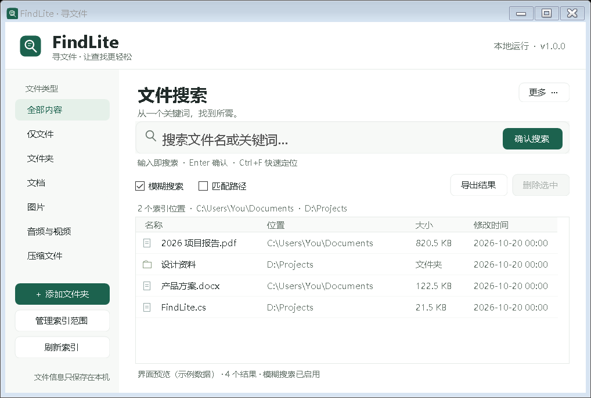

# FindLite · 寻文件

**一个关键词，找到所需。**

轻量、简洁的 Windows 本地文件搜索工具，使用 C# / Windows Forms 独立实现。
支持模糊匹配、文件分类、即时搜索和选中文件移至回收站。MIT 开源。



## 下载

在 [Releases](https://github.com/htdjyj/Findlite/releases) 下载安装版或免安装版。

- 系统：Windows 10 / 11 x64。
- 运行时：.NET Framework 4.8 或更新版本。
- 当前发布包未做数字签名，Windows 可能提示未知发布者。

## 功能

- 输入即搜索，也可点击确认按钮或按 Enter。
- 模糊搜索支持顺序字符和少量错字；直接匹配优先。
- 侧栏提供文件、文件夹、文档、图片、影音和压缩包筛选。
- 按名称、位置、大小、修改时间排序；支持完整路径匹配。
- 双击打开、右键定位和复制路径。
- Ctrl / Shift 多选文件，确认后移至 Windows 回收站。
- CSV 导出；文件变化监听；本地索引缓存。

## 使用

启动后从左侧添加常用文件夹，等候首次扫描。输入名称或关键词进行搜索。

| 搜索示例 | 含义 |
| --- | --- |
| `报告 2026` | 同时包含两个词 |
| `*.pdf\|*.docx` | PDF 或 Word |
| `报告 !草稿` | 排除草稿 |
| `"产品 方案"` | 带空格的短语 |
| `ext:pdf;docx` | 指定扩展名 |
| `path:Downloads` | 路径包含 |
| `type:folder` | 只显示文件夹 |

Ctrl+F 聚焦搜索，Esc 清空，F5 刷新索引。在结果列表中，Enter 打开、Ctrl+Enter 定位、Ctrl+C 复制路径、Delete 移至回收站。

## 隐私与边界

文件名、路径和元数据保存在 `%LOCALAPPDATA%\FindLite\index.json`，不上传索引；不索引文件内容，无账号、遥测或自动更新。用户打开文件或选择网络目录时，相应操作由 Windows 及默认应用处理。

首次索引使用目录遍历，没有实现 NTFS MFT 枚举或 USN Journal 回放；全盘首次扫描可能较慢。权限受限目录、目录联接和长路径可能被跳过。文件变化通知可能丢失，可按 F5 重新校正。暂不支持内容搜索或拼音搜索。

删除功能只处理明确选中的普通文件，操作前确认；目录和链接不在删除范围内。没有永久删除的备用代码路径。

## 构建

Windows 下使用系统 .NET Framework C# 编译器，不需要安装 .NET SDK：

```powershell
git clone https://github.com/htdjyj/Findlite.git
cd findlite
& .\source\build.ps1
```

生成 `portable/FindLite.exe`。构建安装包需要 NSIS 3.11：

```powershell
& .\source\build.ps1 -NsisCompiler 'C:\tools\nsis-3.11\makensis.exe'
```

执行测试：

```powershell
$testRoot = Join-Path $env:TEMP ('FindLite-test-' + [guid]::NewGuid().ToString('N'))
Start-Process .\portable\FindLite.exe -ArgumentList @('--self-test', $testRoot) -Wait
Start-Process .\portable\FindLite.exe -ArgumentList @('--ui-test', $testRoot) -Wait
Start-Process .\portable\FindLite.exe -ArgumentList @('--startup-test', $testRoot) -Wait
Start-Process .\portable\FindLite.exe -ArgumentList @('--menu-test', $testRoot) -Wait
```

测试涵盖查询语法、模糊匹配、排序所依赖的索引、文件监听、UI 同步、启动和菜单生命周期。历史本地验证记录见 [docs/validation.txt](docs/validation.txt)。未声称在所有 Windows 版本与硬件组合上完成验证。

## 贡献

欢迎通过 Issues 提交问题与建议，或通过 Pull Requests 贡献代码。复现问题时请注明 Windows 版本、操作步骤和错误信息，不要上传个人文件索引、真实敏感路径或凭据。

## 许可证与独立实现

本项目采用 [MIT License](LICENSE)。第三方安装框架 NSIS 的许可证单独保留在 `portable/第三方许可-NSIS.txt`，见 [第三方说明](portable/THIRD-PARTY.txt)。

本项目参考文件搜索工具的使用方式进行独立实现，不包含 Everything 的代码、二进制、图标或语言资源，与 voidtools 没有关联。
